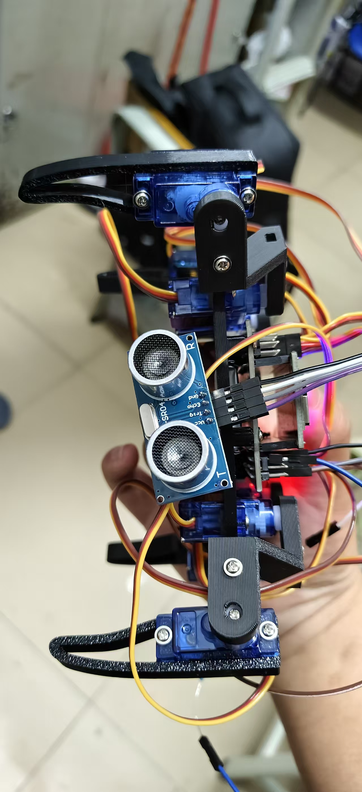
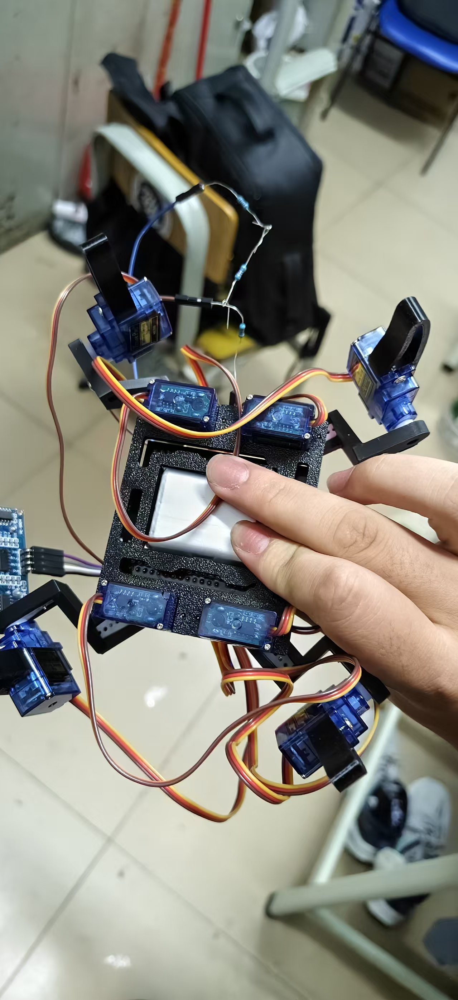
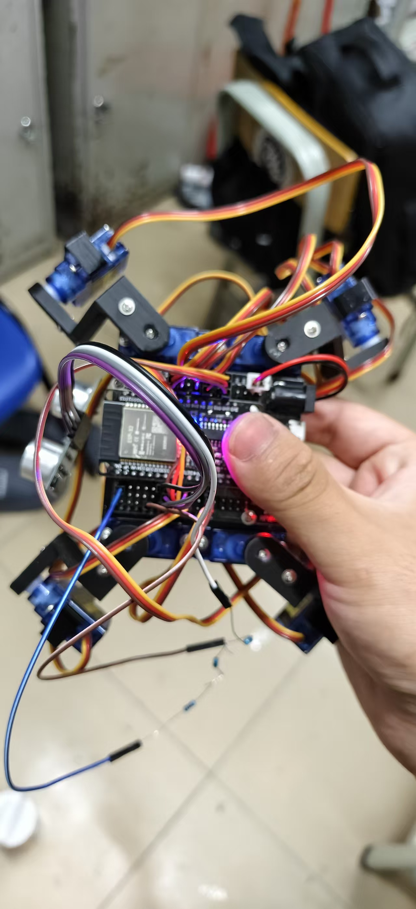
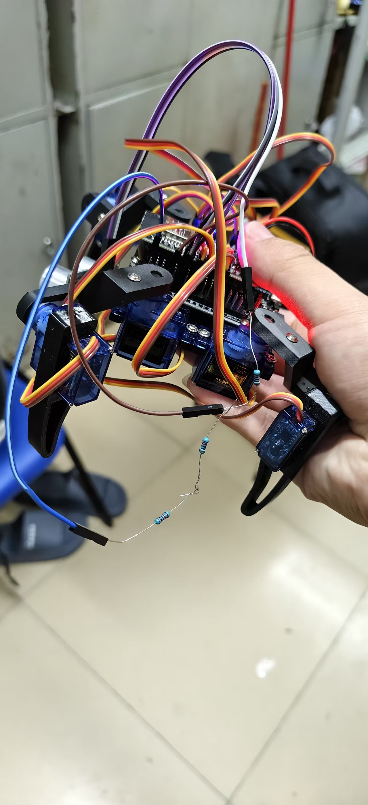
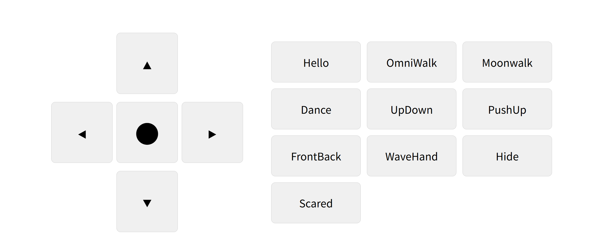
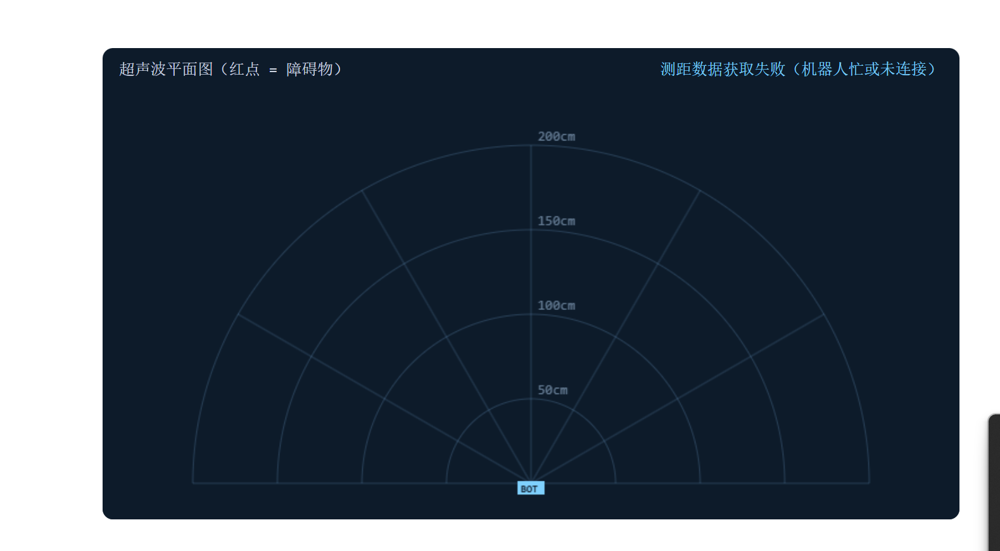

# 简版四足机器人（ESP32 + MicroPython）

ESP32 · MicroPython · 8 舵机 · WiFi 网页遥控 · 超声波测距

用 8 个 180° 舵机搭出一条四足机器人，每条腿 2 个自由度（髋关节 + 小腿）。
ESP32 运行 MicroPython，内置 HTTP 服务器，手机连上热点后用浏览器就能控制行走、
转向和预设动作；板载 HC-SR04 固定朝前测距，网页下方的平面图用红点标记障碍物。

- 完整开源说明、接口与二次开发指南：[OPEN_SOURCE.md](OPEN_SOURCE.md)
- 接线步骤、引脚表与上电检查清单：[WIRING.md](WIRING.md)

---

## 项目展示

| 整机（正面） | 整机（底部） |
|---|---|
|  |  |

| 接线组装 | 舵机走线与分压电阻 |
|---|---|
|  |  |

| 网页控制界面 | 超声波平面图 |
|---|---|
|  |  |

演示视频：[everything/演示视频.mp4](everything/演示视频.mp4)
（GitHub 不支持在 Markdown 中内嵌播放仓库里的 MP4，点击链接播放或下载。）

## 功能特性

- 网页方向控制：前进、后退、左转、右转、回中
- 10 个预设动作：Hello、OmniWalk、Moonwalk、Dance、UpDown、PushUp、
  FrontBack、WaveHand、Hide、Scared
- AP 热点模式 / STA 路由模式
- 超声波实时测距，网页每 400ms 刷新一次平面图
- 障碍物以红色发光点显示，距离圈为 50 / 100 / 150 / 200cm
- HTTP 接口可被脚本或其他设备直接调用
- WiFi 就绪后点亮板载 LED（GPIO2）

## 硬件清单

| 部件 | 数量 | 说明 |
|---|---|---|
| ESP32 开发板 | 1 | 支持 WiFi，刷入 MicroPython 固件 |
| 180° 舵机 | 8 | 四足，每条腿髋关节 + 小腿各 1 个 |
| HC-SR04 | 1 | 超声波测距，固定朝前 |
| 5V 电源 | 1 | 建议 5V / 3A 以上 |
| 电阻 | 2 或 3 个 | ECHO 分压：1kΩ + 2kΩ，或 3 个 10kΩ |
| 电解电容 | 1 | 100µF，并联在舵机电源端 |
| 杜邦线 | 若干 | 建议舵机电源线单独走线 |

## 快速开始

### 1. 刷入固件

给 ESP32 刷入 MicroPython 固件，确认串口可以进入 REPL。

### 2. 上传文件

把以下文件传到开发板根目录：

```text
main.py
quad.py
oscillator.py
robot_wifi.py
scanner.py
index.html
```

`test_servo180.py`、`everything/` 和文档文件不需要上传到开发板。
`index.html` 必须上传，`robot_wifi.py` 启动时会读取它作为网页内容。

使用 `mpremote` 时可以一次传完：

```bash
mpremote cp main.py quad.py oscillator.py robot_wifi.py scanner.py index.html :
```

### 3. 配置 WiFi

默认使用 AP 模式，配置在 [main.py](main.py) 顶部：

```python
AP_SSID = "Otto"
AP_PASSWORD = "88889999"
IFCONFIG = ("192.168.2.182", "255.255.255.0", "192.168.2.1", "8.8.8.8")
```

手机连接热点 `Otto`（密码 `88889999`），浏览器访问：

```text
http://192.168.2.182
```

如需连接路由器，注释掉 `create_connect_ap(...)`，取消 `create_connect_route(...)`
的注释，并填写 `WIFI_SSID` 和 `WIFI_PASSWORD`。此时 ESP32 会从路由器获取 IP，
以串口打印的 `Station IP` 为准。

### 4. 上电运行

复位后串口会打印 IP 地址，浏览器打开该地址即可看到控制界面。

## 接线

### 8 个舵机

```python
SERVO_PINS = (12, 16, 25, 18, 15, 17, 26, 19)
```

顺序：前右髋、前左髋、前右腿、前左腿、后右髋、后左髋、后右腿、后左腿。

```text
            前 (head)
        -----               -----
        |  2  |             |  3  |
        |GPIO25|            |GPIO18|
        ----- -----   ----- -----
            |  0  | |  1  |
            |GPIO12| |GPIO16|
             -----   -----
            |  4  | |  5  |
            |GPIO15| |GPIO17|
        ----- -----   ----- -----
        |  6  |             |  7  |
        |GPIO26|            |GPIO19|
        -----               -----
            后 (tail)
```

- 舵机 VCC 必须接 5V，不能接 3.3V；8 个舵机同时动作电流可能超过 2A，建议独立供电。
- 舵机电源、HC-SR04 与 ESP32 必须共地，并在电源端并联 100µF 电容。
- **断电后改线**，接线完成先运行 `test_servo180.py` 逐个确认方向与零点。

### HC-SR04 超声波

| HC-SR04 | 接到 ESP32 |
|---|---|
| VCC | 5V |
| GND | GND（与 ESP32 共地） |
| TRIG | GPIO 32 |
| ECHO | 分压到 3.3V 后接 GPIO 34 |

ECHO 输出为 5V，**必须分压**后才能接 ESP32：

```text
ECHO ──[1kΩ]──┬──► GPIO34
              │
            [2kΩ]
              │
             GND
```

分压后约 3.33V。只有 10kΩ 电阻时，上端 1 个、下端 2 个串联同样可行。
完整引脚表、接线步骤和检查清单见 **[WIRING.md](WIRING.md)**。

## 网页使用

- 左侧方向键控制移动，中间圆点回中。
- 右侧按钮触发预设动作。
- 下方平面图显示超声波数据：绿色射线为当前探测方向，红点为障碍物。
- 机器人执行动作时会阻塞 HTTP 服务，动作结束后平面图自动恢复更新。

## HTTP 接口

| 方法 | 路径 | 说明 |
|---|---|---|
| GET | `/` | 网页控制界面 |
| GET | `/scan` | 超声波测距数据（JSON） |
| POST | `/control` | 执行动作 |

执行动作：

```bash
curl -X POST http://192.168.2.182/control \
  -H "Content-Type: application/json" \
  -d '{"command": "forward"}'
```

```json
{"status": "200", "msg": "forward"}
```

获取测距数据：

```bash
curl http://192.168.2.182/scan
```

```json
{
  "angle": 90,
  "distance": 62.3,
  "min_angle": 90,
  "max_angle": 90,
  "max_cm": 200,
  "points": [[90, 62.3]]
}
```

`distance` 为 `null` 表示无回波或超出量程。超声波固定朝前，所以角度恒为 90°。

### 可调用动作

| 命令 | 说明 |
|---|---|
| `home` | 回中并卸力 |
| `forward` / `backward` | 前进 / 后退 |
| `turn_L` / `turn_R` | 左转 / 右转 |
| `hello` | 打招呼 |
| `omni_walk` | 全向行走 |
| `moonwalk_L` | 太空步 |
| `dance` | 跳舞 |
| `up_down` | 上下起伏 |
| `push_up` | 俯卧撑 |
| `front_back` | 前后摇摆 |
| `wave_hand` | 单腿挥动 |
| `hide` | 蹲伏收腿 |
| `scared` | 惊吓跳起 |
| `walk` / `walk1` | 早期步态实现，网页未提供按钮 |

`quad.py` 中任意无参公共方法都可以调用；以 `_` 开头的方法、不存在的方法会被拒绝。

## 项目结构

```text
esp32-quadruped/
├── main.py              # 入口：引脚配置、初始化、启动 WiFi 与 HTTP 服务
├── quad.py              # 四足运动库与动作实现（基于 OttoDIY 整理）
├── oscillator.py        # 舵机 PWM 驱动与正弦振荡器
├── robot_wifi.py        # WiFi 连接、HTTP 路由、命令执行
├── scanner.py           # HC-SR04 测距与障碍点缓存
├── index.html           # 网页控制界面与 Canvas 平面图
├── test_servo180.py     # 单舵机接线/角度测试
├── robot.py             # 遗留基类，当前未使用，可删除
├── WIRING.md            # 接线说明与检查清单
├── OPEN_SOURCE.md       # 完整开源说明
├── README.md            # 项目入口文档
├── LICENSE              # Apache License 2.0
└── everything/          # 展示素材：整机照片、界面截图、演示视频
```

核心设计是把每个舵机的运动抽象为正弦振荡：

```text
舵机角度 = 偏移 O + 振幅 A × sin(相位 Ph + 时间相位)
```

调整 8 个舵机的 A / O / T / Ph 四个参数，即可组合出各种步态与动作。

## 参数配置

| 参数 | 位置 | 默认值 | 作用 |
|---|---|---|---|
| `SERVO_PINS` | `main.py` | `(12, 16, 25, 18, 15, 17, 26, 19)` | 8 个舵机引脚顺序 |
| `TRIG_PIN` / `ECHO_PIN` | `main.py` | `32` / `34` | 超声波引脚 |
| `MAX_DISTANCE_CM` | `scanner.py` | `200` | 超出该距离视为无效 |
| `MEASURE_INTERVAL_MS` | `scanner.py` | `100` | 测量间隔 |
| `ECHO_TIMEOUT_US` | `scanner.py` | `30000` | 等待回波的最长时间 |
| `CLEAR_AFTER_MISSES` | `scanner.py` | `10` | 连续无回波多少次后清除红点 |
| `SCAN_POLL_MS` | `index.html` | `400` | 网页请求测距数据的间隔 |
| `maxRangeCm` | `index.html` | `200` | 平面图最大显示距离 |

## 二次开发

新增动作只需两步：

1. 在 `quad.py` 的 `Quad` 类中添加无参方法：

```python
def nod(self, steps=2, t=800):
    amplitude = [10, 10, 0, 0, 10, 10, 0, 0]
    offset = [0, 0, 0, 0, 0, 0, 0, 0]
    period = [t] * self._servo_totals
    phase = [0, 0, 0, 0, 0, 0, 0, 0]
    self._execute(amplitude, offset, period, phase, steps)
```

2. 在 `index.html` 的动作区添加**id 与方法名相同**的按钮：

```html
<div class="button" id="nod">Nod</div>
```

网页按钮直接把 `button.id` 作为命令发送，无需额外注册。
新增接口则在 `robot_wifi.py` 的 `_handle_request` 中增加路径判断。
若要把固定朝前测距改回云台扫描，可重新加入 SG90 舵机按角度步进测量，
`/scan` 的数据结构无需改变。

## 常见问题

**网页打不开**

确认手机已连接热点 `Otto`，或与 ESP32 在同一路由器下，并访问串口打印的 IP。
路由器网段与 `IFCONFIG` 不一致时，固定 IP 可能无法访问。

**舵机抖动或 ESP32 复位**

多为舵机供电不足。建议舵机单独 5V 供电、与 ESP32 共地，并加 100µF 电容。

**超声波一直无回波**

检查 VCC 是否接 5V、TRIG/ECHO 是否接反、ECHO 是否经过分压、是否共地。
障碍物太近（< 2cm）或太远（> 200cm）也会被视为无效。

**红点方向与实际相反**

超声波模块安装方向与代码假设相反，可将 `index.html` 中
`(angle - 90)` 改为 `(90 - angle)`。

**动作时网页无响应**

动作阻塞执行属于正常现象，动作结束后自动恢复。

**修改网页后仍显示旧界面**

浏览器缓存了页面，强制刷新或清除缓存。

更多问题见 [OPEN_SOURCE.md](OPEN_SOURCE.md) 的「常见问题」一节。

## 安全注意事项

- 接线、改线前务必断电。
- ECHO 是 5V 输出，**必须分压**，直连 GPIO 可能损坏 ESP32。
- 调试动作时把机器人架空，避免舵机堵转或机器人跌落。
- 不要将金属物体、液体靠近电路板。

## 相关链接

- Arduino WiFi 版本：<https://github.com/AniPython/quad-arduino-wifi>
- 项目视频：<https://www.bilibili.com/video/BV1vePeepEV4/>


## 许可证

仓库根目录的 `LICENSE` 为 **Apache License 2.0**。

需要注意：`oscillator.py` 顶部保留了上游 GPL 声明（Oscillator.pde / OttoDIY），
`quad.py` 也基于 OttoDIY 项目整理。公开发布前请确认上游许可证与 Apache-2.0
的兼容性，并保留原始版权声明。详见 [OPEN_SOURCE.md](OPEN_SOURCE.md) 的
「许可证与致谢」一节。
